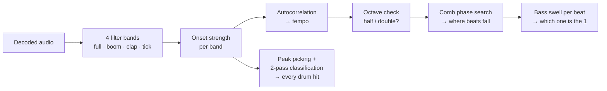

# Count Me In

[](https://github.com/FeruzaAbdukayumova/count-me-in/actions/workflows/ci.yml)

A practice app for dancers. Load a song and it counts **1–8** along with the music, so you always know where the 1 is.

**Live:** https://feruzaabdukayumova.github.io/count-me-in/. It installs to your home screen and works offline.

I built it for my own hip hop classes. Teachers count "5, 6, 7, 8" and everyone else seems to hear where the 1 is. Beginners often don't.

## What it does

- **Song on your device:** the app finds the tempo and the 1 by itself, then plays the song with a click (and optionally a voice) on every count.
- **Song playing somewhere else** (Spotify, a video, the speakers in class): tap along four times and it keeps the count from there.
- **Shows what it's counting:** the booms, claps and ticks slide towards a "now" line, so you can learn to hear the beat yourself.
- **Practice aids:** slow the song down to 50%, light up only the 1 (or the 1 and 5), and get a "5, 6, 7, 8" count-in before the music starts.
- **Your songs:** every song is saved on the device, audio included, and opens with one tap next time.

## How the beat detection works

All of the analysis runs in the browser, in a Web Worker, and nothing is uploaded.



- **Tempo.** It autocorrelates a weighted onset envelope over 55–200 BPM, with a soft preference for tempos around 100. Beats rarely last a whole number of frames, so each lag takes the best of its neighbours. Without that, a half-length lag could win on rounding alone.
- **Octave errors.** A pop groove (boom 1-3, clap 2-4) at 130 BPM correlates exactly like a slow groove at 65. The way to tell them apart is that when you count too slow, real drums keep landing *halfway between* the counts. Hi-hats are left out of this check because they sit on the half counts in nearly every song.
- **Which beat is the 1.** It's the beat where the low end swells the most, measured on raw bass energy rather than onset strength. Onset strength is capped at 1, and a snare's low end hits the cap as easily as a kick's does.
- **Sorting drum hits into lanes.** A drum hit is a click, and a click contains every frequency, so filtering alone can't separate them. Each hit is found once and then classified by the *shape* of its energy in each band, in two passes: booms first, then clap vs. tick, measured only against the hits that aren't booms.

## Architecture

```
src/
  analysis/   pure beat detection: analyze.ts, plus the worker and the decode → analyse pipeline
  engine/     CountEngine (Web Audio clock, scheduling, playback) and grid.ts (pure timing maths)
  library/    IndexedDB song library: settings and audio in separate stores
  ui/         React screens; per-frame drawing writes straight to the DOM and canvas
```

Design decisions:

- **The audio clock is the source of truth, not React.** Ticks are scheduled 160 ms ahead on the `AudioContext` clock from a 25 ms pump, so they land on the beat even when the main thread is busy. React holds only slow-changing state (tempo, options, running) through `useSyncExternalStore`. The count number, the boxes and the canvases update in a `requestAnimationFrame` loop that reads `engine.position()` directly, which avoids 60 re-renders a second.
- **The analysis is a pure function.** `analyze(samples, sampleRate)` has no DOM or Web Audio dependency, so the same code runs in the worker and in the tests.
- **Audio is stored apart from song settings.** Listing your songs never loads megabytes of audio. The newest 30 songs are kept, and `navigator.storage.persist()` asks the browser not to evict them.
- **Saves are debounced but taken at the moment of the change.** The save timer writes the song as it was when it changed, not when the timer fires. Otherwise a quick switch to another song could write the new tempo under the old song. There's a test for that case.

## Testing

```bash
npm test
```

- **Beat detection** is tested against synthetic drum loops (`src/analysis/testing/drumLoop.ts`) whose pattern is known in advance: exact tempo, booms on the right counts, claps on the right counts, ticks on every half count. A sweep test runs two grooves at every tempo from 64 to 124 BPM. The sweep caught three bugs that the original single-file version had: 78 BPM was counted at double speed, at 80 BPM the 1 landed on the clap, and pop grooves from 118 BPM up were counted at half speed.
- **Timing maths** (`grid.ts`): beat indexing, wrap-around, tap tempo with outlier rejection, snapping to the nearest 1.
- **Library:** IndexedDB with `fake-indexeddb`, covering ordering, the 30-song cap with audio cleanup, and updates that keep the stored audio.
- **UI flows** with Testing Library and a fake `AudioContext`: tap a tempo, name a song, find it in Your songs, switch songs quickly, delete one.

CI runs typecheck, lint, tests and the build on every push. Pushes to `main` deploy to GitHub Pages.

## Run locally

```bash
npm install
npm run dev
```

Node 22+. To regenerate the icons from `public/icon.svg`, run `npm run icons`.

## Stack

React 19 · TypeScript (strict) · Vite · Web Audio API · Web Workers · IndexedDB (`idb`) · PWA (`vite-plugin-pwa` / Workbox) · Vitest · Testing Library · oxlint · GitHub Actions
